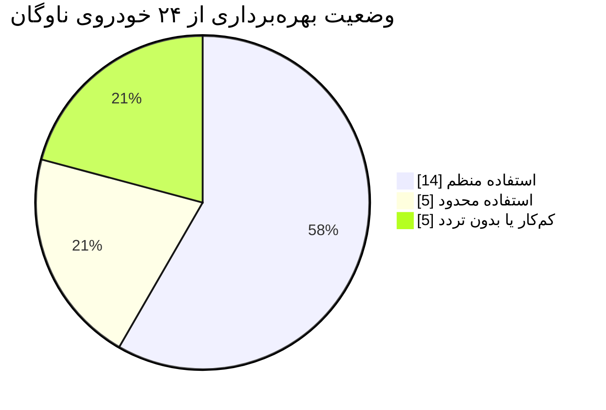
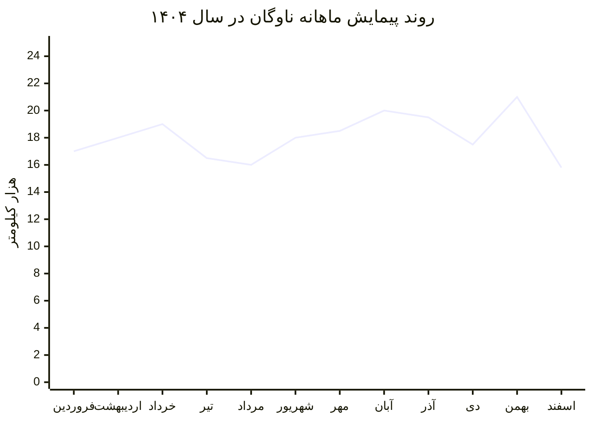
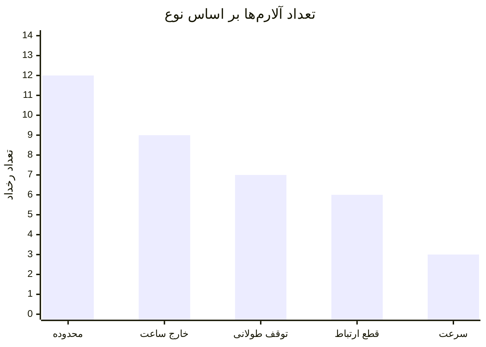
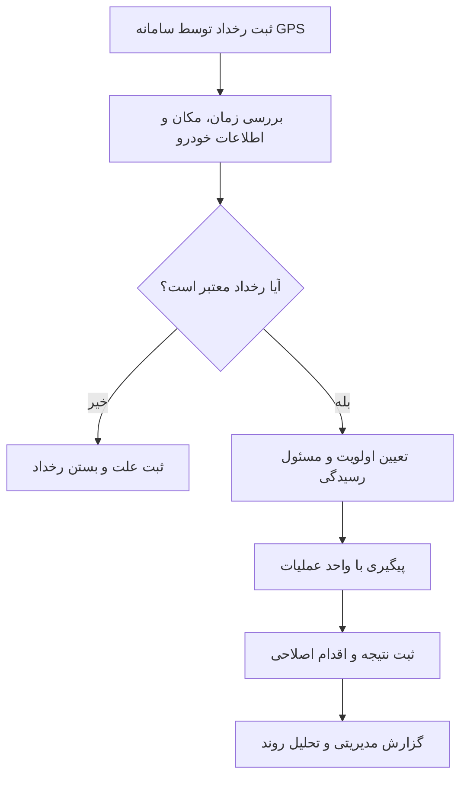
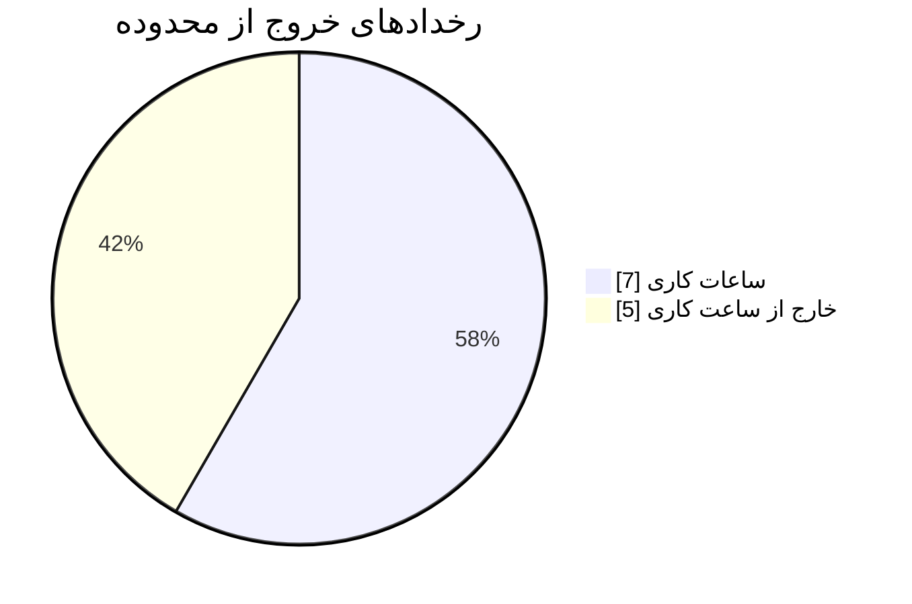
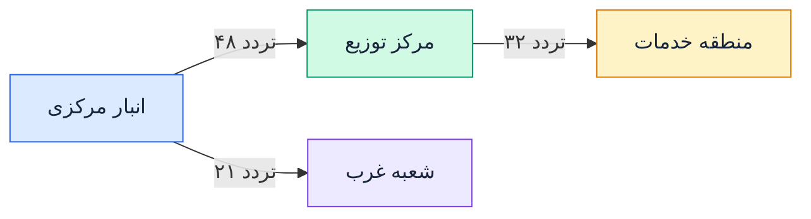
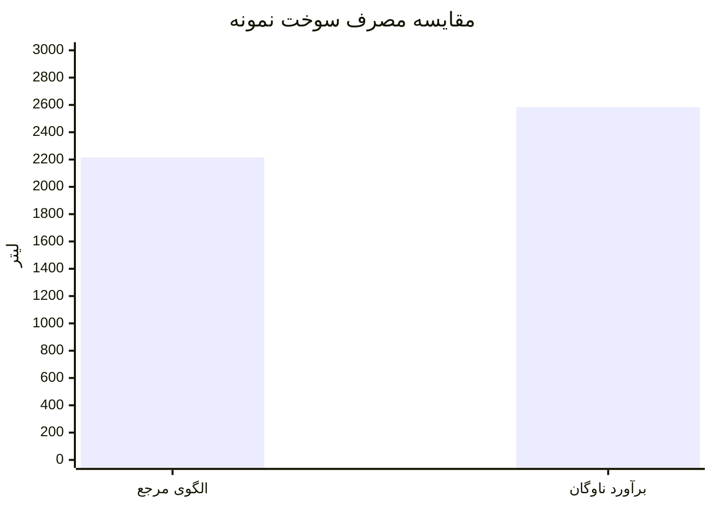
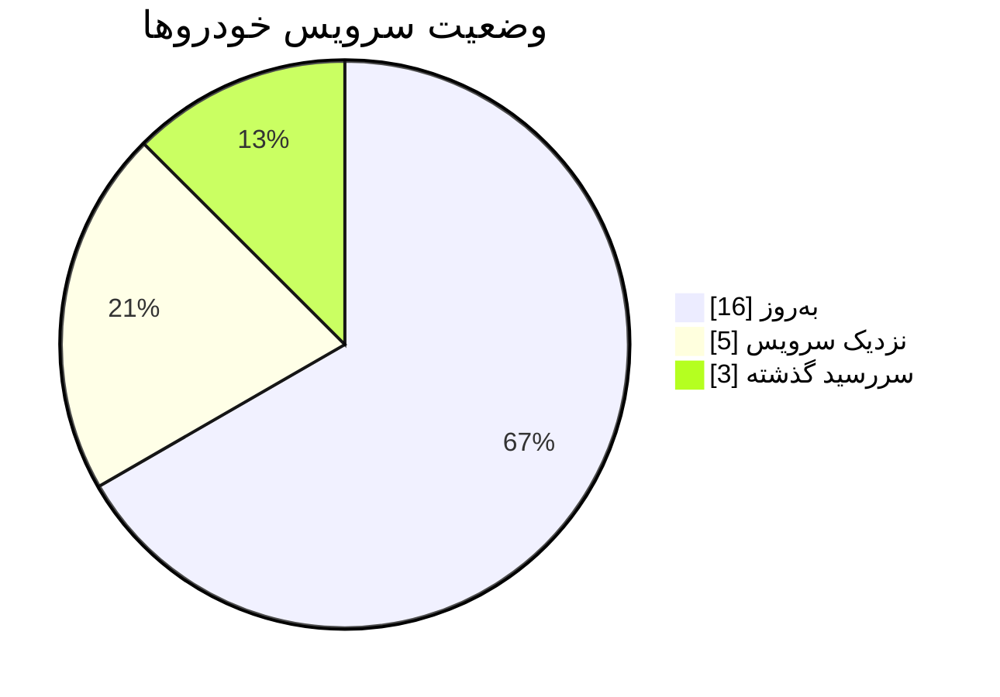

# گزارش هوشمند مدیریت و پایش ناوگان

## GPSTech Fleet Intelligence

**گزارش مدیریتی نمونه | مهر ۱۴۰۵**

| مشخصات گزارش          | مقدار                                          |
| --------------------- | ---------------------------------------------- |
| سازمان                | شرکت نمونه پخش و خدمات                         |
| دوره گزارش            | ۱ تا ۳۰ مهر ۱۴۰۵                               |
| تعداد خودروهای ناوگان | ۲۴ دستگاه                                      |
| تعداد دستگاه‌های GPS  | ۲۴ دستگاه                                      |
| تهیه‌کننده            | سامانه GPSTech                                 |
| وضعیت داده‌ها         | نمونه و فرضی                                   |
| مخاطبان               | مدیرعامل، مدیر عملیات، مدیر ناوگان و واحد مالی |

> **توجه مهم:** تمامی اعداد، هزینه‌ها، رخدادها و مسیرهای این گزارش فرضی هستند و صرفاً برای نمایش قابلیت‌های یک گزارش مدیریتی ارائه شده‌اند. در نسخه عملیاتی، این مقادیر باید از داده‌های واقعی GPS و اطلاعات ثبت‌شده سازمان استخراج شوند.

---

# ۱. خلاصه مدیریتی

هدف این گزارش، ارائه تصویری یکپارچه از وضعیت ناوگان، میزان بهره‌برداری، رفتار حرکتی خودروها، رخدادهای ایمنی، مصرف سوخت و هزینه‌های نگهداری است.

مدیران می‌توانند با استفاده از این اطلاعات، تصمیم‌های دقیق‌تری درباره تخصیص خودروها، کنترل هزینه‌ها، رسیدگی به رخدادها و کاهش توقف‌های عملیاتی اتخاذ کنند.

## شاخص‌های کلیدی عملکرد

| شاخص                            |        مقدار نمونه | توضیح                        |
| ------------------------------- | -----------------: | ---------------------------- |
| تعداد خودروها                   |          ۲۴ دستگاه | کل ناوگان تحت پایش           |
| مسافت پیموده‌شده                |     ۱۸٬۴۶۰ کیلومتر | مجموع پیمایش ثبت‌شده         |
| ساعات فعالیت                    |         ۱٬۱۲۶ ساعت | برآورد ساعات فعالیت          |
| آلارم‌های ثبت‌شده               |           ۳۷ رخداد | مجموع رخدادهای دسته‌بندی‌شده |
| آلارم‌های نیازمند بررسی         |            ۸ رخداد | موارد اولویت‌دار             |
| دستگاه‌های آنلاین در پایان دوره |          ۲۲ دستگاه | ۹۱٫۷٪ ناوگان                 |
| مصرف سوخت تخمینی                |         ۲٬۵۸۴ لیتر | بر اساس ضریب فرضی مصرف       |
| هزینه تخمینی سوخت               | ۱۲۹٫۲ میلیون تومان | بر اساس نرخ فرضی هر لیتر     |
| دستورکارهای تعمیراتی            |            ۱۲ مورد | داده نمونه                   |
| ساعات توقف تعمیراتی             |            ۴۱ ساعت | توقف ثبت‌شده فرضی            |

## ارزیابی کلی

- **بهره‌برداری:** بررسی خودروهای کم‌کار می‌تواند به شناسایی ظرفیت بلااستفاده کمک کند.
- **ایمنی و کنترل:** آلارم‌های محدوده جغرافیایی و فعالیت خارج از ساعت کاری نیازمند بررسی هستند.
- **هزینه سوخت:** ارقام فعلی تخمینی‌اند و برای تصمیم مالی باید با اطلاعات واقعی سوخت‌گیری تطبیق داده شوند.
- **نگهداری:** سه خودرو در نمونه حاضر از موعد سرویس دوره‌ای عبور کرده‌اند.
- **دسترس‌پذیری:** دو دستگاه در لحظه تهیه گزارش آنلاین نبوده‌اند و وضعیت ارتباط آن‌ها باید بررسی شود.

---

# ۲. عملکرد و بهره‌برداری ناوگان

## ۲.۱. مسافت پیموده‌شده

مجموع پیمایش ثبت‌شده ناوگان در مهرماه برابر با ۱۸٬۴۶۰ کیلومتر است.

| شاخص                                 |            مقدار |
| ------------------------------------ | ---------------: |
| مجموع پیمایش                         |   ۱۸٬۴۶۰ کیلومتر |
| میانگین پیمایش ماهانه هر خودرو       | حدود ۷۶۹ کیلومتر |
| بیشترین پیمایش ثبت‌شده برای یک خودرو |    ۱٬۴۸۰ کیلومتر |
| کمترین پیمایش در نمونه خودروهای فعال |      ۹۴۰ کیلومتر |
| خودروهای کم‌کار یا بدون تردد         |         ۵ دستگاه |

### نمودار ۱ ـ توزیع سطح استفاده از خودروها

### تفسیر مدیریتی

- خودروهای کم‌کار باید از نظر نیاز عملیاتی، تخصیص نامناسب، خرابی یا نبود داده بررسی شوند.
- خودروهای پرتردد باید از نظر سرویس دوره‌ای، استهلاک، مصرف سوخت و رعایت ساعات کاری پایش شوند.
- اختلاف پیمایش خودروهای مشابه می‌تواند مبنایی برای بررسی نحوه تخصیص مأموریت‌ها باشد.

## ۲.۲. روند پیمایش ماهانه

نمودار زیر یک نمونه نمایشی از روند پیمایش ناوگان در سال ۱۴۰۴ است.

**جمع پیمایش سالانه نمونه:** ۲۱۶٬۸۰۰ کیلومتر

این نمودار می‌تواند در گزارش واقعی برای تشخیص فصل‌های پرتردد، افت فعالیت، افزایش غیرعادی پیمایش و تغییرات تقاضای عملیاتی استفاده شود.

## ۲.۳. ساعات فعالیت

| شاخص                                       | مقدار نمونه |
| ------------------------------------------ | ----------: |
| مجموع ساعات فعالیت                         |  ۱٬۱۲۶ ساعت |
| میانگین ساعت فعالیت هر خودرو               |   ۴۶٫۹ ساعت |
| تعداد خودروهای نیازمند بررسی الگوی استفاده |    ۵ دستگاه |

> تعریف «ساعت فعالیت» باید در نسخه عملیاتی مشخص باشد؛ برای مثال، زمان حرکت، زمان روشن بودن موتور یا بازه حضور در مأموریت. این معیارها یکسان نیستند.

---

# ۳. تحلیل آلارم‌ها و رخدادهای عملیاتی

آلارم‌ها یکی از مهم‌ترین ابزارهای کنترل ناوگان هستند. گزارش مدیریتی باید علاوه بر تعداد رخدادها، شدت، زمان وقوع، خودرو، مدت رخداد و وضعیت رسیدگی را نشان دهد.

## ۳.۱. توزیع آلارم‌ها

در نمونه حاضر ۳۷ رخداد ثبت شده است.

| نوع آلارم                      |  تعداد |                          سهم تقریبی |
| ------------------------------ | -----: | ----------------------------------: |
| خروج از محدوده مجاز            |     ۱۲ |                                 ۳۲٪ |
| فعالیت خارج از ساعت کاری       |      ۹ |                                 ۲۴٪ |
| توقف طولانی در محل غیرمجاز     |      ۷ |                                 ۱۹٪ |
| قطع ارتباط یا وقفه دریافت داده |      ۶ |                                 ۱۶٪ |
| عبور از سرعت تعریف‌شده         |      ۳ |                                  ۸٪ |
| **مجموع**                      | **۳۷** | **۱۰۰٪ با اختلاف ناشی از گرد کردن** |

## ۳.۲. نمونه رخدادهای مهم

| تاریخ  | خودرو    | رخداد            | اطلاعات تکمیلی          | اولویت |
| ------ | -------- | ---------------- | ----------------------- | ------ |
| ۱۴ مهر | خودرو ۰۳ | خروج از محدوده   | ۲۶ دقیقه خارج از محدوده | بالا   |
| ۱۹ مهر | خودرو ۱۱ | فعالیت شبانه     | حرکت ساعت ۰۱:۴۲         | بالا   |
| ۲۱ مهر | خودرو ۰۸ | وقفه دریافت داده | ۳۷ دقیقه بدون داده      | متوسط  |
| ۲۶ مهر | خودرو ۰۶ | توقف طولانی      | ۲ ساعت و ۱۸ دقیقه       | متوسط  |

### نمودار فرایند رسیدگی به آلارم

## ۳.۳. شاخص‌های پیشنهادی آلارم

برای ارزیابی کیفیت کنترل ناوگان، شاخص‌های زیر در گزارش‌های ماهانه محاسبه شوند:

- تعداد کل آلارم‌ها به تفکیک خودرو و نوع رخداد
- تعداد آلارم‌های مهم و بحرانی
- متوسط زمان رسیدگی به رخداد
- درصد آلارم‌های بررسی‌شده و بسته‌شده
- تعداد رخدادهای تکرارشونده برای هر خودرو
- تعداد آلارم‌های ناشی از ضعف ارتباط یا کیفیت داده

**نکته:** ثبت آلارم به‌تنهایی اثبات‌کننده تخلف نیست. شرایط مأموریت، تنظیمات سامانه، صحت داده GPS و شواهد تکمیلی باید بررسی شوند.

---

# ۴. محدوده‌های جغرافیایی و کنترل تردد

محدوده جغرافیایی یا Geofence امکان تعریف نواحی مجاز و دریافت رخداد هنگام ورود یا خروج خودرو را فراهم می‌کند.

## ۴.۱. نمونه وضعیت محدوده‌ها

| شاخص                             | مقدار نمونه |
| -------------------------------- | ----------: |
| محدوده‌های فعال                  |    ۶ محدوده |
| رخدادهای ورود و خروج             |    ۸۶ رخداد |
| خروج از محدوده در ساعات کاری     |      ۷ مورد |
| خروج از محدوده خارج از ساعت کاری |      ۵ مورد |

## ۴.۲. نمونه محدوده‌های قابل تعریف

| محدوده        | کاربرد                        | سیاست پیشنهادی            |
| ------------- | ----------------------------- | ------------------------- |
| انبار مرکزی   | کنترل ورود و خروج خودروها     | ثبت زمان ورود و خروج      |
| شعب توزیع     | اندازه‌گیری حضور در شعب       | گزارش زمان توقف           |
| محل پروژه     | کنترل حضور خودروهای عملیاتی   | هشدار خروج غیرمجاز        |
| منطقه ممنوعه  | جلوگیری از تردد در مناطق مشخص | آلارم با اولویت بالا      |
| پارکینگ شبانه | کنترل محل توقف پایان روز      | هشدار خروج در ساعات ممنوع |
| تعمیرگاه      | ثبت مراجعه برای سرویس         | تطبیق مراجعه با دستورکار  |

### نمودار توزیع نمونه رخدادهای محدوده

## ۴.۳. گزارش مدیریتی محدوده

گزارش واقعی می‌تواند برای هر محدوده این اطلاعات را نمایش دهد:

- تعداد ورود و خروج هر خودرو
- اولین زمان ورود و آخرین زمان خروج
- مدت توقف در محدوده
- تعداد خروج‌های غیرمجاز
- خودروهای دارای بیشترین رخداد
- نقشه نقاط و مسیرهای مرتبط با رخداد
- فهرست رخدادهای بررسی‌نشده

---

# ۵. نقشه مسیرهای پرتردد و تحلیل مسیر

نقشه مسیرها برای مدیر عملیات، مدیر توزیع و مدیر ناوگان ارزش بالایی دارد؛ زیرا علاوه بر نمایش موقعیت فعلی، می‌تواند الگوی رفت‌وآمد و استفاده از مسیرها را روشن کند.

## ۵.۱. نمونه مسیرهای پرتردد

| مسیر                      | تعداد تردد فرضی | کاربرد          |
| ------------------------- | --------------: | --------------- |
| انبار مرکزی تا مرکز توزیع |          ۴۸ بار | مسیر پرتردد اول |
| مرکز توزیع تا منطقه خدمات |          ۳۲ بار | مسیر پرتردد دوم |
| انبار مرکزی تا شعبه غرب   |          ۲۱ بار | مسیر پرتردد سوم |

### نمایش شماتیک مسیرها

> **توجه:** این نمایش، نقشه جغرافیایی واقعی نیست؛ مسیرها برای نمایش ساختار گزارش فرضی هستند. در نسخه عملیاتی باید از نقاط GPS ثبت‌شده و نقشه واقعی استفاده شود.

## ۵.۲. شاخص‌های تحلیل مسیر

- مسیرهای پرتکرار هر خودرو یا گروه خودروها
- تعداد دفعات عبور از یک مسیر مشخص
- متوسط زمان پیمایش مسیر
- مدت توقف در نقاط پرتکرار
- مسیرهای دارای توقف یا انحراف غیرعادی
- اختلاف زمان پیمایش مسیر در ساعات مختلف
- مقایسه مسیر برنامه‌ریزی‌شده با مسیر ثبت‌شده، در صورت وجود برنامه مأموریت

## ۵.۳. ارزش مدیریتی

تحلیل مسیرها می‌تواند به شناسایی فرصت‌های بهینه‌سازی برنامه توزیع، کاهش مسیرهای تکراری، تشخیص توقف‌های طولانی و بررسی تفاوت عملکرد خودروهای مشابه کمک کند.

> مسیر پرتردد لزوماً مسیر غیربهینه نیست. برای ارزیابی واقعی باید مسافت، زمان، ترافیک، نوع مأموریت و محدودیت‌های عملیاتی هم‌زمان بررسی شوند.

---

# ۶. مصرف سوخت و هزینه انرژی

مصرف سوخت یکی از مهم‌ترین بخش‌های مالی گزارش ناوگان است. با این حال، **مسافت GPS به‌تنهایی مصرف واقعی سوخت را مشخص نمی‌کند.**

در این نمونه، مصرف بر اساس ضریب فرضی ۱۴ لیتر در هر ۱۰۰ کیلومتر محاسبه شده است.

## ۶.۱. خلاصه سوخت

| شاخص              |                  مقدار نمونه |
| ----------------- | ---------------------------: |
| مسافت پیموده‌شده  |               ۱۸٬۴۶۰ کیلومتر |
| مصرف فرضی         |    ۱۴ لیتر در هر ۱۰۰ کیلومتر |
| مصرف تخمینی       |                 ۲٬۵۸۴٫۴ لیتر |
| نرخ فرضی سوخت     | ۵۰٬۰۰۰ تومان به‌ازای هر لیتر |
| هزینه تخمینی سوخت |      حدود ۱۲۹٫۲ میلیون تومان |

فرمول محاسبه:

\[
\text{مصرف تخمینی} =
\frac{\text{مسافت پیموده‌شده} \times \text{مصرف در ۱۰۰ کیلومتر}}{100}
\]

\[
\text{هزینه سوخت} =
\text{مصرف تخمینی} \times \text{قیمت هر لیتر}
\]

## ۶.۲. مقایسه با الگوی استاندارد فرضی

فرض کنیم الگوی مرجع ناوگان ۱۲ لیتر در هر ۱۰۰ کیلومتر باشد.

| شاخص                     |                  مقدار |
| ------------------------ | ---------------------: |
| مصرف با الگوی مرجع       |           ۲٬۲۱۵٫۲ لیتر |
| مصرف برآوردی نمونه       |           ۲٬۵۸۴٫۴ لیتر |
| اختلاف                   |             ۳۶۹٫۲ لیتر |
| هزینه اختلاف با نرخ فرضی | حدود ۱۸٫۵ میلیون تومان |

### نکات مهم در تفسیر مصرف

افزایش مصرف می‌تواند ناشی از عوامل مختلفی باشد:

- ترافیک و توقف درجا
- بار خودرو و نوع مأموریت
- وضعیت فنی موتور، لاستیک و سیستم انتقال قدرت
- انتخاب مسیر و شرایط جغرافیایی
- تفاوت نوع خودرو و استاندارد مصرف آن
- خطای تخمین یا ناقص بودن داده‌ها

### روش‌های افزایش دقت

۱. ثبت مقدار و مبلغ هر سوخت‌گیری به همراه تاریخ و کیلومترشمار

۲. استفاده از سنسور سطح سوخت سازگار یا اطلاعات ECU در صورت پشتیبانی خودرو و سخت‌افزار

۳. مقایسه مصرف واقعی با مسافت ثبت‌شده و نوع خودرو

۴. ثبت مغایرت‌ها و بررسی موارد غیرعادی

**پیشنهاد:** در گزارش نهایی، مصرف واقعی ثبت‌شده و مصرف تخمینی GPS در دو ستون جداگانه نمایش داده شوند تا مدیران تفاوت این دو را اشتباه تفسیر نکنند.

---

# ۷. تعمیر و نگهداری پیشگیرانه

اتصال اطلاعات پیمایش به برنامه تعمیر و نگهداری، به مدیر ناوگان کمک می‌کند تا سرویس‌های دوره‌ای را قبل از ایجاد خرابی برنامه‌ریزی کند.

## ۷.۱. وضعیت سرویس دوره‌ای

| وضعیت              | تعداد خودرو |
| ------------------ | ----------: |
| سرویس به‌روز       |          ۱۶ |
| نزدیک موعد سرویس   |           ۵ |
| عبور از موعد سرویس |           ۳ |
| **مجموع**          |      **۲۴** |

## ۷.۲. نمونه برنامه نگهداری

| فعالیت                  | وضعیت نمونه           | اقدام پیشنهادی            |
| ----------------------- | --------------------- | ------------------------- |
| تعویض روغن و فیلتر      | ۴ خودرو نزدیک موعد    | برنامه‌ریزی سرویس         |
| بازبینی لاستیک و ترمز   | ۳ خودرو نیازمند بررسی | تعیین وقت بازدید          |
| بررسی سیستم برق و باتری | ۲ مورد گزارش‌شده      | عیب‌یابی                  |
| سرویس دوره‌ای           | ۳ خودرو با موعد گذشته | اولویت‌بندی و پیگیری      |
| بررسی خرابی تکرارشونده  | نیازمند ثبت سابقه     | تحلیل هزینه و دفعات تعمیر |

## ۷.۳. شاخص‌های نگهداری

برای گزارش‌های دوره‌ای، شاخص‌های زیر پیشنهاد می‌شوند:

- هزینه تعمیرات به‌ازای هر خودرو
- هزینه تعمیرات به‌ازای هر کیلومتر
- تعداد خرابی‌های تکراری
- متوسط زمان توقف تعمیراتی
- درصد سرویس‌های انجام‌شده در موعد مقرر
- تعداد خودروهای دارای سرویس سررسیدشده
- مقایسه هزینه نگهداری خودروهای هم‌رده

## ۷.۴. نمونه گزارش هزینه تعمیرات

| گروه هزینه             | سهم فرضی |
| ---------------------- | -------: |
| سرویس دوره‌ای          |      ۳۲٪ |
| لاستیک، ترمز و جلوبندی |      ۲۸٪ |
| برق و تجهیزات          |      ۲۲٪ |
| سایر موارد             |      ۱۸٪ |

**نکته اجرایی:** GPS به‌تنهایی هزینه تعمیرات یا وضعیت قطعات را ثبت نمی‌کند. این بخش نیازمند ثبت سوابق سرویس، فاکتورها، کیلومترشمار و دستورکارهای تعمیرگاهی است.

---

# ۸. وضعیت اتصال و سلامت دستگاه‌های GPS

سلامت ارتباط دستگاه‌ها مستقیماً بر کیفیت گزارش‌های موقعیت و آلارم اثر می‌گذارد.

| شاخص                      | مقدار نمونه |
| ------------------------- | ----------: |
| تعداد کل دستگاه‌ها        |          ۲۴ |
| آنلاین در زمان تهیه گزارش |          ۲۲ |
| آفلاین در زمان تهیه گزارش |           ۲ |
| دسترس‌پذیری لحظه‌ای       |       ۹۱٫۷٪ |

## موارد پیشنهادی برای بررسی

- آخرین زمان دریافت داده از هر دستگاه
- مدت زمان سپری‌شده از آخرین ارتباط
- تعداد قطعی‌های ارتباطی در دوره
- کیفیت و پیوستگی داده‌های موقعیت
- وضعیت سیم‌کارت و پوشش شبکه، در صورت دسترسی به اطلاعات مربوط
- احتمال خاموش بودن خودرو یا قطع برق دستگاه
- تفاوت میان آفلاین بودن دستگاه و توقف خودرو

> آنلاین بودن دستگاه در یک لحظه، معادل دسترس‌پذیری کل ماه نیست. برای محاسبه دسترس‌پذیری ماهانه باید مدت زمان آنلاین بودن و بازه مورد انتظار دریافت داده مشخص باشد.

---

# ۹. جدول مقایسه عملکرد خودروها

جدول زیر نمونه‌ای از گزارش جزئیات ناوگان است.

| خودرو          | پیمایش (km) | ساعت فعالیت |  آلارم | وضعیت سرویس  |    مصرف تخمینی |
| -------------- | ----------: | ----------: | -----: | ------------ | -------------: |
| خودرو ۰۱       |       ۱٬۴۸۰ |          ۸۲ |      ۱ | به‌روز       |       ۲۰۷ لیتر |
| خودرو ۰۳       |       ۱٬۲۶۰ |          ۷۴ |      ۵ | نزدیک سرویس  |       ۱۷۶ لیتر |
| خودرو ۰۶       |         ۹۴۰ |          ۵۸ |      ۳ | سررسید گذشته |       ۱۳۲ لیتر |
| خودرو ۰۸       |       ۱٬۱۱۰ |          ۶۳ |      ۲ | به‌روز       |       ۱۵۵ لیتر |
| خودرو ۱۱       |       ۱٬۳۵۰ |          ۷۸ |      ۴ | نزدیک سرویس  |       ۱۸۹ لیتر |
| ۲۰ خودروی دیگر |      ۱۲٬۳۲۰ |         ۷۷۱ |     ۲۲ | ترکیبی       |     ۱٬۷۲۵ لیتر |
| **جمع**        |  **۱۸٬۴۶۰** |   **۱٬۱۲۶** | **۳۷** | —            | **۲٬۵۸۴ لیتر** |

مصرف خودروها در این جدول بر اساس ضریب فرضی ۱۴ لیتر در هر ۱۰۰ کیلومتر محاسبه شده و به نزدیک‌ترین لیتر گرد شده است.

### نمونه اقدامات مدیریتی

| اولویت | مورد                          | اقدام                                    |
| ------ | ----------------------------- | ---------------------------------------- |
| بالا   | خودرو با آلارم‌های متعدد      | بررسی رخدادها و ثبت نتیجه رسیدگی         |
| بالا   | خودرو با سرویس سررسیدشده      | برنامه‌ریزی تعمیرگاه                     |
| متوسط  | دستگاه با وقفه دریافت داده    | بررسی دستگاه و شرایط ارتباط              |
| متوسط  | خودرو با پیمایش بسیار پایین   | بررسی تخصیص مأموریت یا علت عدم استفاده   |
| متوسط  | اختلاف مصرف واقعی و استاندارد | اعتبارسنجی سوخت‌گیری و بررسی شرایط خودرو |

---

# ۱۰. گزارش سالانه ناوگان

این بخش نمونه‌ای از نمای سالانه برای ارائه به مدیرعامل یا هیئت‌مدیره است.

## ۱۰.۱. شاخص‌های سالانه

| شاخص                           |         مقدار نمونه |
| ------------------------------ | ------------------: |
| تعداد خودرو                    |                  ۲۴ |
| مجموع پیمایش سالانه            |     ۲۱۶٬۸۰۰ کیلومتر |
| میانگین پیمایش سالانه هر خودرو |       ۹٬۰۳۳ کیلومتر |
| متوسط پیمایش ماهانه کل ناوگان  | حدود ۱۸٬۰۶۷ کیلومتر |
| ساعات فعالیت سالانه            |         ۱۳٬۴۲۰ ساعت |

## ۱۰.۲. جدول پیمایش ماهانه

| ماه      | پیمایش (هزار کیلومتر) | ساعات فعالیت نمونه |
| -------- | --------------------: | -----------------: |
| فروردین  |                  ۱۷٫۰ |              ۱٬۰۵۰ |
| اردیبهشت |                  ۱۸٫۰ |              ۱٬۱۰۰ |
| خرداد    |                  ۱۹٫۰ |              ۱٬۱۵۰ |
| تیر      |                  ۱۶٫۵ |              ۱٬۰۲۰ |
| مرداد    |                  ۱۶٫۰ |                ۹۸۰ |
| شهریور   |                  ۱۸٫۰ |              ۱٬۱۰۰ |
| مهر      |                  ۱۸٫۵ |              ۱٬۱۳۰ |
| آبان     |                  ۲۰٫۰ |              ۱٬۲۲۰ |
| آذر      |                  ۱۹٫۵ |              ۱٬۲۰۰ |
| دی       |                  ۱۷٫۵ |              ۱٬۰۷۰ |
| بهمن     |                  ۲۱٫۰ |              ۱٬۲۸۰ |
| اسفند    |                  ۱۵٫۸ |              ۱٬۱۲۰ |
| **جمع**  |             **۲۱۶٫۸** |         **۱۳٬۴۲۰** |

> ساعات فعالیت این جدول برای نمایش قالب گزارش نمونه‌سازی شده‌اند. در گزارش واقعی، مقادیر باید با تعریف یکسانی از فعالیت و داده‌های کامل دوره محاسبه شوند.

## ۱۰.۳. تحلیل سالانه پیشنهادی

- مقایسه پیمایش هر ماه با ماه مشابه سال قبل
- شناسایی ماه‌های اوج فعالیت و افت بهره‌برداری
- مقایسه خودروهای هم‌رده از نظر مسافت، ساعات فعالیت و هزینه
- بررسی روند آلارم‌های مهم در طول سال
- مقایسه هزینه سوخت و نگهداری با پیمایش
- شناسایی خودروهایی که هزینه بالایی نسبت به میزان استفاده دارند

---

# ۱۱. داشبورد مدیریتی پیشنهادی

در نسخه عملیاتی، بهتر است گزارش علاوه بر فایل PDF یا HTML، در قالب یک داشبورد تعاملی نیز قابل مشاهده باشد.

## نمای مدیرعامل

تمرکز بر شاخص‌های سطح بالا:

- هزینه کل عملیات
- پیمایش و میزان بهره‌برداری
- روند هزینه سوخت و تعمیرات
- رخدادهای مهم و حل‌نشده
- مقایسه ماهانه و سالانه

## نمای مدیر عملیات

تمرکز بر اجرای روزانه:

- موقعیت و وضعیت آنلاین خودروها
- خودروهای فعال و متوقف
- مسیرهای پرتردد
- خروج از محدوده
- فعالیت خارج از ساعت کاری
- فهرست رخدادهای نیازمند پیگیری

## نمای مدیر ناوگان

تمرکز بر عملکرد هر خودرو:

- پیمایش و ساعات فعالیت
- سابقه مسیر و توقف
- آلارم‌ها و تاریخچه رخدادها
- زمان سررسید سرویس
- هزینه نگهداری و سوخت ثبت‌شده

## نمای واحد مالی

تمرکز بر کنترل هزینه:

- هزینه سوخت به‌ازای هر خودرو
- هزینه نگهداری به‌ازای هر کیلومتر
- مقایسه هزینه واقعی و بودجه
- اختلاف هزینه خودروهای هم‌رده
- روند هزینه ماهانه و سالانه

---

# ۱۲. شاخص‌های کلیدی عملکرد (KPI)

برای مقایسه عملکرد در طول زمان، پیشنهاد می‌شود شاخص‌های زیر در هر دوره به‌صورت ثابت محاسبه شوند.

| شاخص                          | روش محاسبه                                       | کاربرد                 |
| ----------------------------- | ------------------------------------------------ | ---------------------- |
| میانگین پیمایش خودرو          | پیمایش کل ÷ تعداد خودرو                          | سنجش استفاده از ناوگان |
| نرخ آنلاین بودن               | زمان آنلاین ÷ زمان مورد انتظار × ۱۰۰             | بررسی سلامت ارتباط     |
| نرخ رسیدگی به آلارم           | آلارم‌های رسیدگی‌شده ÷ آلارم‌های معتبر × ۱۰۰     | سنجش پیگیری رخدادها    |
| مصرف سوخت به‌ازای ۱۰۰ کیلومتر | لیتر واقعی ÷ کیلومتر × ۱۰۰                       | کنترل بهره‌وری سوخت    |
| هزینه تعمیرات به‌ازای کیلومتر | هزینه تعمیرات ÷ پیمایش                           | مقایسه هزینه خودروها   |
| نرخ انجام سرویس در موعد       | سرویس‌های به‌موقع ÷ کل سرویس‌های سررسیدشده × ۱۰۰ | کنترل نگهداری          |
| متوسط زمان توقف               | مجموع ساعات توقف ÷ تعداد رخدادهای توقف           | سنجش اختلال عملیاتی    |
| نرخ خروج غیرمجاز              | خروج‌های تأییدشده غیرمجاز ÷ کل مأموریت‌ها × ۱۰۰  | بررسی انضباط تردد      |

در محاسبه این شاخص‌ها، مخرج و تعریف هر معیار باید برای تمام خودروها یکسان باشد. برای مثال، نرخ رسیدگی به آلارم باید بر اساس آلارم‌های معتبر و دارای وضعیت رسیدگی محاسبه شود، نه صرفاً همه رخدادهای خام.

---

# ۱۳. برنامه اقدام پیشنهادی برای ماه آینده

| اقدام                       | مسئول پیشنهادی     | اولویت          | معیار ارزیابی               |
| --------------------------- | ------------------ | --------------- | --------------------------- |
| بررسی ۸ آلارم مهم           | مدیر عملیات        | بالا            | ثبت نتیجه برای هر رخداد     |
| رسیدگی به ۳ سرویس سررسیدشده | مسئول نگهداری      | بالا            | تکمیل سرویس و ثبت کیلومتر   |
| بررسی ۲ دستگاه آفلاین       | پشتیبانی فنی       | بالا            | مشخص شدن علت و وضعیت ارتباط |
| اعتبارسنجی اطلاعات سوخت     | واحد مالی و ناوگان | متوسط           | تطبیق سوخت‌گیری با پیمایش   |
| بررسی ۵ خودروی کم‌کار       | مدیر ناوگان        | متوسط           | تعیین علت کم‌کاری           |
| تعریف سیاست محدوده‌ها       | مدیر عملیات        | متوسط           | ثبت محدوده و ساعات مجاز     |
| تهیه گزارش ماهانه بعدی      | مدیر سامانه        | برنامه‌ریزی‌شده | انتشار گزارش در موعد مقرر   |

---

# ۱۴. ارزش تجاری سامانه GPSTech برای سازمان‌ها

یک سامانه مدیریت ناوگان زمانی ارزش مدیریتی ایجاد می‌کند که داده خام GPS را به اطلاعات قابل بررسی و اقدام تبدیل کند.

قابلیت‌های قابل ارائه در گزارش، بسته به سخت‌افزار، داده‌های موجود و امکانات فعال سامانه، می‌تواند شامل موارد زیر باشد:

- **پایش موقعیت و مسیر:** مشاهده موقعیت خودروها و تاریخچه پیمایش
- **گزارش‌های مدیریتی:** خلاصه عملکرد روزانه، ماهانه و سالانه
- **مدیریت آلارم‌ها:** ثبت و بررسی رخدادهای تعریف‌شده
- **محدوده‌های جغرافیایی:** کنترل ورود و خروج از مناطق مشخص
- **تحلیل توقف‌ها:** بررسی توقف‌های طولانی و الگوهای عملیاتی
- **مدیریت سرویس:** ارتباط پیمایش با برنامه نگهداری، در صورت ثبت اطلاعات سرویس
- **گزارش سوخت:** تحلیل داده واقعی سوخت‌گیری یا اطلاعات سنسور سازگار
- **گزارش سازمانی:** تهیه خروجی مناسب مدیران، واحد مالی و مسئول ناوگان

## پیام اصلی برای مدیران

**هدف صرفاً مشاهده موقعیت خودرو نیست؛ هدف، ایجاد دید مدیریتی نسبت به استفاده از ناوگان، رخدادها و هزینه‌های عملیاتی است.**

با ترکیب داده‌های GPS و اطلاعات تکمیلی سازمان، می‌توان تصمیم‌های مستندتری برای تخصیص خودرو، رسیدگی به رخدادها، برنامه‌ریزی نگهداری و کنترل هزینه‌ها اتخاذ کرد.

---

# ۱۵. روش‌شناسی و محدودیت‌های گزارش

برای جلوگیری از برداشت اشتباه در ارائه سازمانی، موارد زیر باید در گزارش نهایی مشخص باشند:

1. **منبع داده:** GPS، سنسور سوخت، اطلاعات تعمیرگاه یا ثبت دستی
2. **بازه زمانی:** تاریخ شروع و پایان دقیق گزارش
3. **تعریف فعالیت:** حرکت، روشن بودن موتور یا زمان مأموریت
4. **تعریف آلارم:** نوع رخداد، شرایط فعال‌سازی و وضعیت رسیدگی
5. **تعریف پیمایش:** روش محاسبه فاصله و نحوه برخورد با داده‌های ناقص
6. **روش محاسبه سوخت:** داده واقعی یا برآورد بر اساس ضریب مصرف
7. **روش محاسبه هزینه:** مبلغ ثبت‌شده، نرخ ثابت یا برآورد
8. **کیفیت داده:** میزان قطعی ارتباط، داده‌های ناقص و خطاهای احتمالی

نقشه شماتیک، نمودارهای نمایشی و داده‌های فرضی این فایل نباید به‌عنوان عملکرد واقعی یک سازمان ارائه شوند. برای استفاده نهایی، اعداد باید با داده‌های معتبر جایگزین و محاسبات دوباره انجام شوند.

---

# جمع‌بندی نهایی

گزارش مدیریتی ناوگان GPSTech می‌تواند نقطه شروعی برای تصمیم‌گیری داده‌محور در سازمان‌ها باشد. ترکیب پیمایش، وضعیت ارتباط، آلارم‌ها، محدوده‌های جغرافیایی، تحلیل مسیر و اطلاعات واقعی سوخت و نگهداری، تصویر کامل‌تری از وضعیت عملیات ارائه می‌دهد.

ارزش نهایی گزارش زمانی بیشتر می‌شود که هر شاخص به یک اقدام قابل پیگیری، مسئول مشخص و معیار ارزیابی متصل باشد.

**GPSTech — مدیریت هوشمند ناوگان، از موقعیت خودرو تا تحلیل عملکرد عملیات.**
